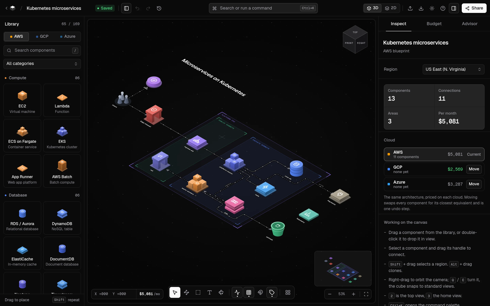
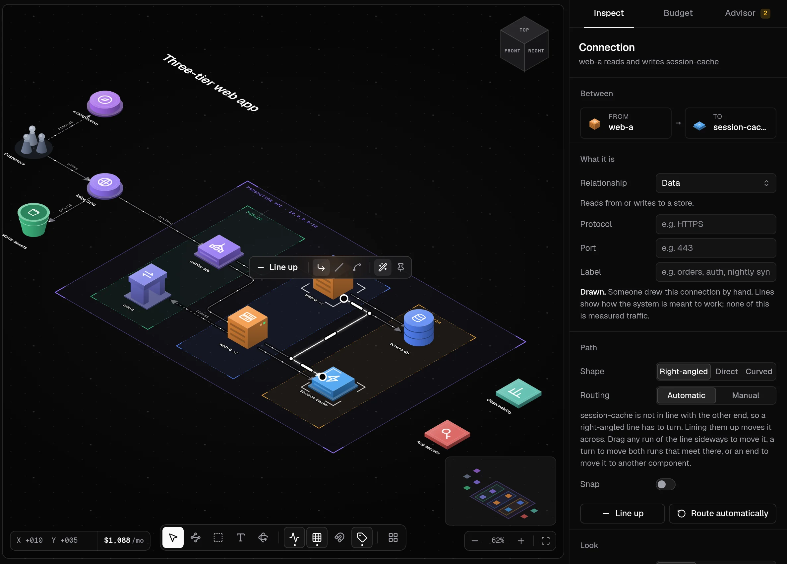
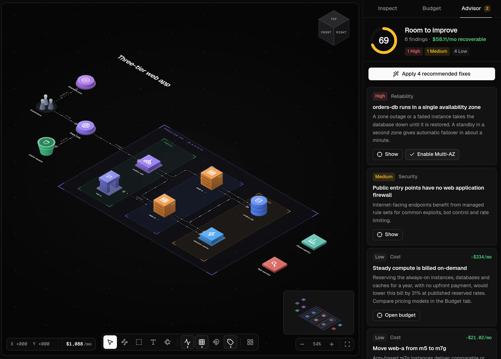
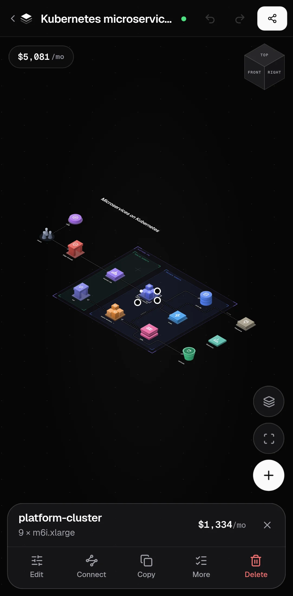

<div align="center">

# CloudMill Graph

**The design studio for cloud architecture.**

Design AWS, Google Cloud and Azure systems on an isometric 3D canvas, with real
cloud components, connections that carry meaning, and an architecture review
built in.<br>
It runs entirely in your browser. No account, no server, nothing uploaded.

[**Open the app**](https://graph.cloud-mill.com) · [Features](#features) · [Quick start](#quick-start)

</div>

<picture>
  <source media="(prefers-color-scheme: light)" srcset=".github/assets/editor-light.webp">
  
</picture>

## Why

Cloud architecture is still designed in tools made for boxes and arrows. They
do not know what a subnet is, what talks to what, or whether the design holds
up.

CloudMill Graph is a studio made for the job. You compose a system from real
cloud services, group them into networks and zones, and connect them with lines
that say what travels along them. Because the result is a model and not a
picture, it can be reviewed, moved between clouds, and exported as Terraform.

## Features

### Design in three dimensions

A real orbit camera over an isometric scene, not a flat board with tilted
icons.

- **169 cloud services** across AWS, Google Cloud and Azure, ready to place and
  configure.
- **Structure like the real thing.** Areas for VPCs, subnets, zones and groups,
  with labels on the ground.
- **Orbit, tilt and turn** around any point, snap to standard views with the
  view cube, or switch to a flat top view in one click.
- **Six starter blueprints**, from a three-tier web app to a streaming data
  platform, or begin on a blank canvas.
- **What you place stays put.** Nothing is nudged, re-routed or tidied behind
  your back: what is on screen when you let go is what is saved.

### Connections that mean something



- **Every line carries a relationship** (request, data, event, replication or
  dependency), with a protocol and a port.
- **Lines route themselves** in clean right angles around everything in the
  way, and moving dots show which way traffic runs.
- **Shape any line by hand** and it is kept exactly as you left it, or switch
  it to a direct or curved stroke.
- **Follow the flow** lights up everything upstream and downstream of a
  component.

### A reviewer built in



- **Thirteen checks** for reliability, security, cost and hygiene: single
  points of failure, databases in one zone, exposed data stores, missing
  firewalls, idle load balancers and more.
- **A score for the design**, with findings ranked by severity.
- **One-click fixes**, one at a time or all the recommended ones together.

### One architecture, three clouds

Design it once and move it. One click swaps every component for its closest
equivalent on another cloud, and one undo brings it back.

### Terraform, both ways

Paste HCL and get a laid-out diagram: resources become components, references
become connections, and VPC membership becomes areas. Export any blueprint back
to HCL for the `aws`, `google` and `azurerm` providers.

### Cost, when you want it

Every design carries a monthly estimate built on public list prices, with a
heatmap on the canvas to show where the money goes and the same design priced
on each cloud.

### Yours, and easy to share



- **Nothing leaves your browser.** Blueprints autosave locally, with version
  history.
- **Share by link.** The whole diagram is compressed into the URL, so there is
  nothing to upload and nothing to sign in to.
- **Export** to PNG, SVG, Terraform, JSON and CSV.
- **At home on a phone.** A layout of its own with map-style gestures: drag,
  pinch, twist to turn, two fingers to tilt. It installs to the home screen.
- **Fast to drive.** A command palette (`⌘K` or `Ctrl K`), keyboard shortcuts
  throughout, undo and redo, auto-layout, a minimap, and light and dark themes.

<br clear="all">

## Quick start

Try it now at [graph.cloud-mill.com](https://graph.cloud-mill.com), or run it
locally with Node 20 or newer:

```bash
npm install
npm run dev
```

Open <http://localhost:5183> and start from a sample blueprint.

## Development

| Command            | What it does                                      |
|--------------------|---------------------------------------------------|
| `npm run dev`      | Start the dev server                              |
| `npm run build`    | Typecheck and build for production                |
| `npm test`         | Unit and component tests                          |
| `npm run test:e2e` | End-to-end tests in Google Chrome                 |
| `npm run verify`   | Everything: types, lint, tests, build, end-to-end |
| `npm run bench`    | Measure frame times on blueprints of any size     |

The project is held to a high bar: more than 1,300 unit and component tests,
about 600 end-to-end tests across desktop and four phone profiles, a 98%
coverage floor, WCAG 2.1 AA checks in both themes, and tests that photograph
the canvas to prove it stays sharp at every frame of a zoom.

## Under the hood

React 19, TypeScript, Zustand and Vite. The canvas is plain SVG with no drawing
library, and there is no backend.

```
src/core     projection maths, catalog and pricing, routing, layout, advisor,
             Terraform import and export, storage
src/canvas   isometric models, the renderer, the interactive canvas, image export
src/ui       editor shell, panels, dialogs, dashboard
```

One pure renderer draws the editor, the thumbnails, the previews and the
exports, so what you export is what you saw.

---

Cost figures are estimates from public list prices. CloudMill Graph is an
independent project; AWS, Google Cloud and Azure service names are used for
reference only.
